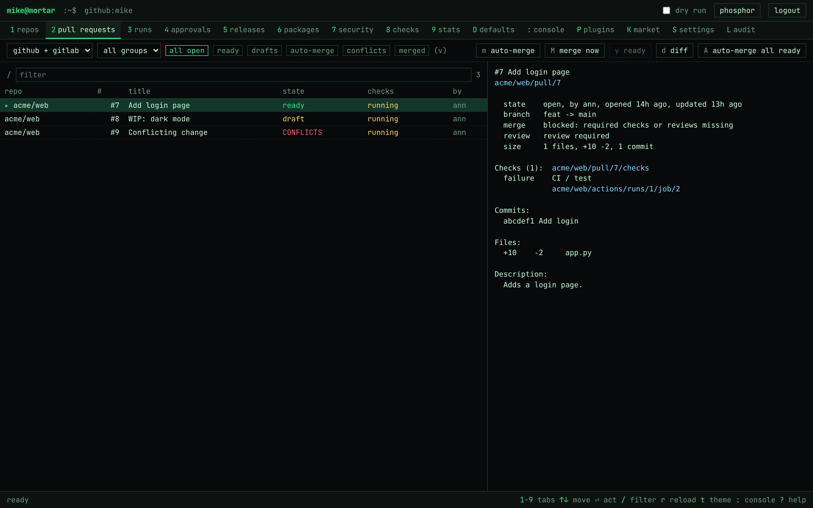

# Mortar

Mortar (the `mtr` command) is a terminal tool, TUI and web app for looking after many GitHub (and, in the web app, GitLab) repositories at once, across orgs and user accounts: status, pull requests, merges, workflow runs and approvals, security alerts, stats, and drift checks against shared defaults. It holds your bricks together.

The defaults live in a repository you choose. Point `mtr` at any repo (or local folder) that holds a `mortar.toml`, and it checks your repos against it. Nothing is tied to one org: every user can keep their own defaults repo.

## Install

Mortar isn't on PyPI yet, so install it from GitHub with pipx. The `tui` extra adds `mtr tui`, `server` adds `mtr serve` (the web app), and `market` adds signature checks for `mtr market`:

```sh
pipx install "mortar-cli[tui,server] @ git+https://github.com/bitsandbricks-ch/mortar-cli"
gh auth login          # on its own, mtr talks to GitHub through the gh CLI and never sees a token
mtr init your-org/your-defaults
```

To update: `pipx install --force "mortar-cli[tui,server] @ git+https://github.com/bitsandbricks-ch/mortar-cli"`. A pipx install doesn't include the web UI's built files; run the web app from the Docker image or a clone (see [Mortar (web app)](#mortar-web-app)).

The repository used to be `bitsandbricks-ch/bitsandbricks-cli` with a `bnb` command. Only the names `mtr`, `MTR_*`, `mortar.toml` and `~/.config/mortar` work now.

## Commands

Repos are named as `owner/name`, as a bare `name` when only one repo has it, or by their group alias (the group's `prefix` dropped, so `plugin-budgets` is also `budgets`). `name#12` is a pull request. Without names a command runs on every repo of your orgs. `--org` and `--group` narrow it down, and `--dry-run` shows what would change.

| Command | What it does |
|---|---|
| `mtr init <owner/repo or folder>` | Use this defaults repo. A local folder without `mortar.toml` gets a starter file. |
| `mtr config` | Where mtr looks: config file, defaults, orgs, groups, plugins. |
| `mtr repos` | The repos mtr sees, with their group. |
| `mtr status` | One line per repo: group, latest release, PRs ready/draft, CI. One GraphQL query per 20 repos. |
| `mtr prs` | Open PRs with checks, reviews, conflicts and auto-merge. |
| `mtr pr web#12 [--diff] [--body]` | One PR in detail: merge state, failing checks with links, files, description (`--body`: all of it). Takes a PR URL too. |
| `mtr merge [names] [--now] [--ready] [--method squash\|merge\|rebase]` | Auto-merge open PRs (or merge now; squash by default). Drafts and conflicts stay open; `--ready` marks named drafts ready first. |
| `mtr runs [--failed] [--limit 3]` | Latest workflow runs per repo. |
| `mtr rerun name [--run ID] [--yes]` | Re-runs the failed jobs of the repo's newest failed run (or of run ID), after listing its jobs and the step that failed. Jobs that passed and approvals already given stay. |
| `mtr releases [--problems]` | Each repo's latest release, its assets, and its release runs. Flags assets the group's `release_assets` wants but the release lacks, and a failed last release run with the job and step that failed. |
| `mtr packages [--problems]` | Container images on GHCR of your orgs: newest tags, whether the repo's latest release has an image with its tag, and a failed last image build (a run named or filed like image, docker or container) with the job and step that failed. |
| `mtr bump name [patch\|minor\|major\|1.4.0] [--auto-merge]` | Opens a PR on `bump/v<new>` that sets the version in the group's `version` file (plugin.yaml, pyproject.toml, package.json, VERSION, ...) and adds the section to each `changelog`: Keep a Changelog `[Unreleased]` entries become `## [1.4.0] - date`, otherwise a `## 1.4.0` section lists the PRs merged since the last release. Default: patch. |
| `mtr release [names] [--yes] [--list]` | Pushes the tag `v<version>` on the default branch of each named repo whose version is newer than its latest release (and whose first changelog has the section), after asking. The repo's own workflow builds and publishes. When the tag is there already it shows its release run. No names (or `--list`): a table of version against latest release. |
| `mtr approve [--yes]` | Runs waiting for you: environments you review, and outside contributors' runs. A run that waits for someone else says why you can't approve it, for example "Prevent self-review" when you started it and are its only reviewer. |
| `mtr security` | Open Dependabot, secret scanning and code scanning alerts. |
| `mtr doctor [names] [--fix]` | Settings, security, release immutability, rulesets and files against the defaults. `--fix` applies them. |
| `mtr sync [names] [--only PATH]` | Opens a PR per repo whose shared files differ. |
| `mtr issues [names] [--mine] [--label L] [--assignee X] [--stale DAYS] [--state open\|closed\|all] [--limit 20]` | Issues across repos, newest activity first; PRs are left out. `--assignee none` shows unassigned ones, `*` any assigned; `--label` repeats. |
| `mtr issue new name "title" [--body TEXT] [--label L] [--assignee X]` | Opens an issue (`--body -` reads it from stdin). `mtr issue view\|close\|reopen name#12` shows, closes (`--not-planned`) or reopens one, `mtr issue comment name#12 "text"` comments. An issue URL works too. |
| `mtr workflows [names] [--fix]` | Risky GitHub Actions workflows: actions not pinned to a commit, `write-all` or missing `permissions`, `pull_request_target` that checks out the PR, script injection from `${{ github.event... }}`. `--fix` opens a PR per repo that pins the actions to commit SHAs. |
| `mtr new owner/name [--group G] [--public] [--description TEXT]` | Creates a repo the way its group wants it: from the reference repo when that is a GitHub template, the group's files committed, then its settings, security and rulesets applied. Private unless `--public`. |
| `mtr open web#12 [--actions] [--releases]` | Prints the link, and opens it (or copies it over SSH; `MTR_OPEN=browser\|copy\|print`). `--actions` and `--releases` link those pages of a repo. |
| `mtr stats [--days 30]` | Pull requests merged and opened, median time to merge, open and stale PRs, workflow runs with success rate and duration, releases. |
| `mtr plugins` | Installed plugins. |
| `mtr market [install NAME] [--index URL]` | Plugins in the signed plugin index; `install` adds one (only from a verified index). `keygen`, `sign` and `verify` are for whoever publishes an index. |
| `mtr serve [--host 127.0.0.1] [--port 8080]` | Runs Mortar, the web app, on Flask's development server (needs the `server` extra). `mtr serve --check` shows what its settings allow and what is missing. See [docs/mortar.md](docs/mortar.md). |
| `mtr login https://mortar [--read] [--key KEY]` | Go through [Mortar](docs/mortar.md), the web app, with an API key: mtr shows a code, you approve it in the browser, and every command and the TUI then work without gh or a GitHub token here. `--read` asks for a read-only key, `--key` uses one you made in Settings › API keys. `mtr logout` forgets the key, `mtr whoami` says how mtr reaches GitHub and as whom. |
| `mtr tui` | Everything above, full screen. |

Security alerts need the `security_events` scope and packages the `read:packages` scope: `gh auth refresh -s security_events,read:packages`.

## TUI

`mtr tui` has tabs for Repos, Pull requests, Runs, Releases, Packages, Security, Checks (doctor plus plugin checks) and Settings (defaults repo, orgs, groups, plugins, theme, config file), plus any tabs that plugins add. Issues and workflow hardening are commands and web app tabs, not TUI tabs yet.

- **Keys per row:** the footer and the top of the right side list only the keys that do something for the selected row (approve only on a run that waits, re-run only on a failed one, ready only on a draft).
- **Pull requests:** **u** updates the branch from its base, **c** comments, **C** closes without merging, besides merge, ready and diff.
- **Runs:** the right side lists the selected run's jobs with the step that failed. **a** approves, **x** re-runs the failed jobs, **l** shows the end of each failed job's log, **C** cancels a running run.
- **Repos** show the version file against the latest release, CI on the default branch, alerts and missing release assets. **Releases** show the version, the release notes and what failed in the last release run.
- **Repos and Releases:** **b** bumps the selected repo's version (pick patch, minor or major; opens the PR), **R** pushes its release tag once the bump is merged.
- **Enter** on a row opens it as a full page: what you can do with it on the left (Enter or the key in brackets runs it), its whole detail on the right, and what the actions printed at the bottom. **Esc** goes back to the list. On Checks and Settings, Enter opens a short menu instead.
- **The footer** only shows the keys that work on the current tab.
- **n** creates a new repo.
- **ctrl+p** lists every command.
- **Loading:** nothing reloads by itself. The repo and PR list loads at start, with one GraphQL query per 20 repos. Runs, Releases, Packages and Security load the first time you open their tab. **r** reloads the tab you are on.
- **Rate limit:** the header shows how many API calls are left. Answers are cached for 60 seconds. If GitHub's rate limit is reached, the TUI says when it resets instead of failing.

## Configuration

Your own config is `~/.config/mortar/config.toml` (`mtr init` writes it):

```toml
defaults = "your-org/your-defaults"   # a GitHub repo, or a local folder
ref = "main"                          # optional branch or tag
orgs = ["another-org"]                # added to the orgs the defaults name
repos = ["someone/their-repo"]        # added to the defaults' repos
exclude = ["another-org/archive-*"]   # added to the defaults' exclude
```

It lives in `$XDG_CONFIG_HOME/mortar` when that is set, and `MTR_CONFIG` points mtr at another file. `MTR_DEFAULTS`, `MTR_DEFAULTS_REF` and `MTR_ORGS` (comma separated, replacing the orgs) override it for one run.

| Variable | What it does |
|---|---|
| `MTR_CONFIG` | Your config file, instead of `~/.config/mortar/config.toml`. |
| `MTR_DEFAULTS`, `MTR_DEFAULTS_REF` | The defaults repo (or folder) and its branch or tag. |
| `MTR_ORGS` | The orgs to look at, comma separated. |
| `MTR_SERVER`, `MTR_KEY` | Go through Mortar with this URL and API key (for CI). `MTR_SERVER=` (set but empty) uses gh even after `mtr login`. |
| `MTR_OPEN` | How `mtr open` opens links: `browser`, `copy` or `print`. |
| `MTR_PLUGINS` | `none`, or a comma separated list of the plugins to load. |
| `MTR_PLUGIN_INDEX`, `MTR_PLUGIN_INDEX_KEYS` | The plugin index for `mtr market`, and extra public keys (base64, comma separated) it may be signed with. |

`mortar.toml` in the defaults repo is shared by everyone who points mtr at it:

```toml
orgs = ["your-org", "your-user"]
repos = ["someone/one-more-repo"]
exclude = ["your-org/old-*"]

[[group]]
name = "plugins"
match = { org = "your-org", prefix = "plugin-" }   # also: suffix, repos, exclude, topics, provider
from = "your-org/plugin-template"                  # a live reference repo
files = [".gitignore", "LICENSE"]                  # files that must match the reference
require = { allow_auto_merge = true }              # what the reference itself must have

[[group]]
name = "default"                                   # no match: takes the rest
settings = { delete_branch_on_merge = true, has_wiki = false }
security = { secret_scanning = "enabled", secret_scanning_push_protection = "enabled",
             dependabot_alerts = "enabled", dependabot_security_updates = "enabled" }
immutable_releases = true
vulnerability_reporting = true
topics = ["your-org"]                              # topics every repo has
labels = { bug = "d73a4a", docs = { color = "0075ca", description = "Documentation" } }
actions = { allowed_actions = "selected", default_workflow_permissions = "read",
            can_approve_pull_request_reviews = false }
required_files = ["README.md", "LICENSE", "CODEOWNERS|.github/CODEOWNERS"]   # A|B: either one
branch = "main"                                    # the default branch's name
visibility = "private"                             # public, private or internal
description = true                                 # every repo has a description
workflows = { allow_unpinned = ["actions/*"] }     # doctor checks the workflows too (or: workflows = true)
skip = ["labels"]                                  # checks this group leaves out
release_assets = ["*.zip"]                         # files every release must attach (mtr releases)
version = "pyproject.toml"                         # the file with the version (mtr bump, mtr release)
changelog = ["CHANGELOG.md"]                       # changelogs mtr bump adds the section to
rulesets = "rulesets/default"                      # ruleset JSON files (export them from GitHub)
files = "files/default"                            # copied into each repo, path for path
```

The first group that matches a repo is its group. With `from`, the group takes everything from the reference repo as it is live on GitHub (settings, security, release immutability, rulesets), so changing the reference changes what every repo of the group should have. Explicit `settings`, `security` and `rulesets` go on top.

A ruleset from the defaults folder only has to be covered: a repo may set more than the file says (GitHub fills in its own defaults). A reference repo's rulesets must match exactly. Each repo's own `.github/rulesets/*.json` must also match what's live, and `doctor --fix` imports them.

`doctor --fix` sets settings, security (Dependabot alerts and security updates too), topics (it adds the missing ones and keeps the rest), labels (it creates missing ones and fixes colors, and leaves other labels alone) and the Actions permissions. `branch`, `visibility`, `description` and `required_files` are only checked, because changing them can break things: a missing required file is a job for `mtr sync` or a PR.

`skip` turns checks off for a group: `settings`, `security`, `vulnerability_reporting`, `immutable_releases`, `rulesets`, `own_rulesets` (the repo's `.github/rulesets`), `files`, `required_files`, `topics`, `labels`, `actions`, `branch`, `visibility`, `description`, `workflows` and `plugins` (the plugins' doctor checks).

`workflows` makes doctor check the group's workflow files like `mtr workflows` does. It takes `true` or a table: `pinned`, `permissions`, `pull_request_target` and `injection` turn single checks off with `false`, and `allow_unpinned = ["actions/*", "your-org/*"]` lets actions of owners you trust stay on a tag. `mtr workflows --fix` keeps the tag as a comment (`uses: actions/checkout@<sha> # v4`), so Dependabot and Renovate keep updating the pins.

Unknown keys on a group stay there for plugins (`group.extra`).

## Plugins

A plugin is a Python package with an entry point in the `mortar.plugins` group. It can add commands, `status` columns (with extra GraphQL fields), doctor checks and hints, TUI tabs and palette commands. See `src/mortar/plugins.py`.

```toml
[project.entry-points."mortar.plugins"]
myplugin = "my_package.mortar:MyPlugin"
```

Install one next to mtr with `pipx inject mortar-cli <package>`. `MTR_PLUGINS=none` (or a comma separated list of names) limits which plugins load.

hubra-cli is one: it adds Hubra plugin releases, signing checks and a Hubra tab.

## Mortar (web app)

`mtr serve` runs mtr as a web app. People sign in with their own GitHub or GitLab account (OAuth, so every
call uses their own token) and get every command and TUI view in a terminal-style browser UI, plus issues,
workflow hardening, a defaults editor with templates, stats, a console, plugins and a signed plugin
marketplace. It works on a phone too. `mtr login https://your-mortar` points the CLI and TUI at it with an
API key, so a laptop needs neither gh nor a token.

The quickest way to run it is Docker, which builds the UI too:

```sh
cp deploy/mortar.env.example deploy/mortar.env       # fill in MTR_URL, an OAuth app, who may sign in
docker compose -f deploy/docker-compose.yml up -d    # Mortar and Postgres, on 127.0.0.1:8080
```

From a clone, for development:

```sh
pip install -e ".[server]" && (cd web && npm ci && npm run build)
export MTR_ADMINS=github:you                         # optional: GitHub sign-in works as is
mtr serve --check && mtr serve                       # http://localhost:8080
```



Setup, settings, the security model and more screenshots: [docs/mortar.md](docs/mortar.md).

## Roadmap

Ideas and planned features live in [docs/BACKLOG.md](docs/BACKLOG.md).

## Development

```sh
pip install -e ".[dev]"
pytest          # runs every command against tests/fake_gh, a stand-in for gh
ruff check .
cd web && npm ci && npm run build   # Mortar's UI (npm run dev for a live-reloading one)
```

## License

MIT, see [LICENSE](LICENSE).
